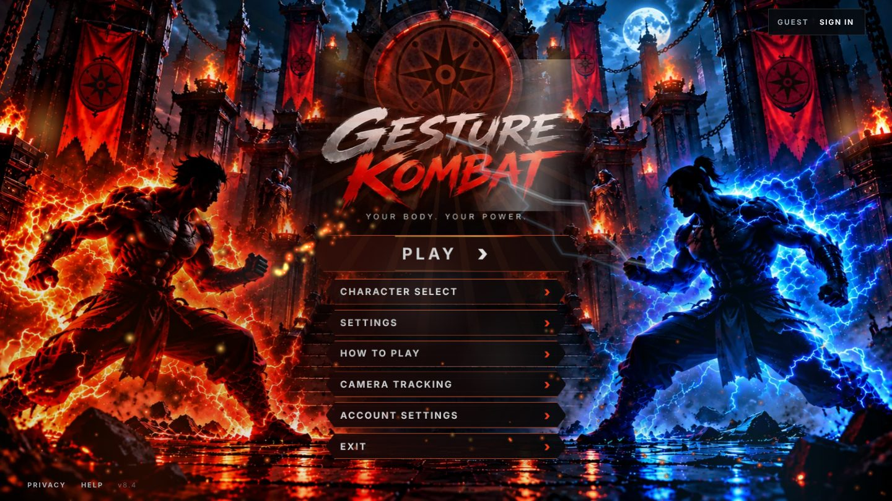
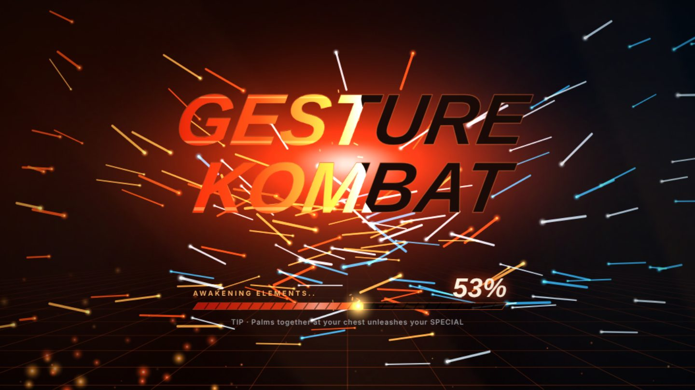
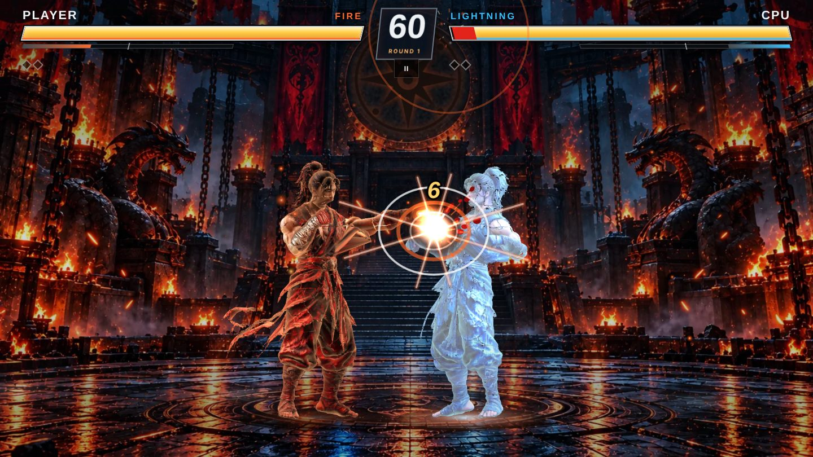
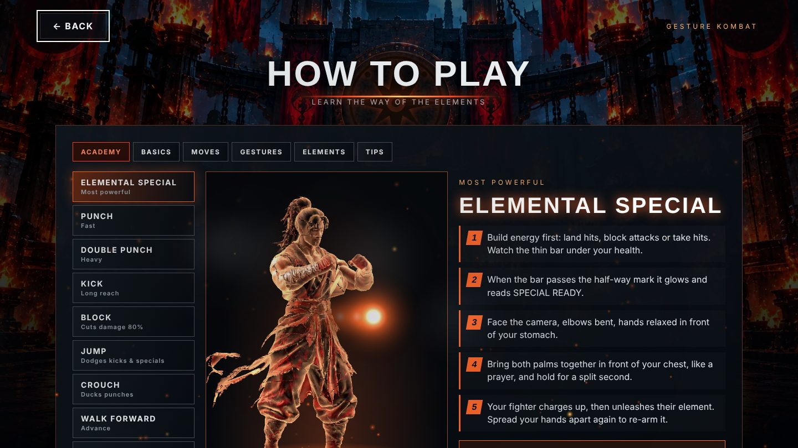
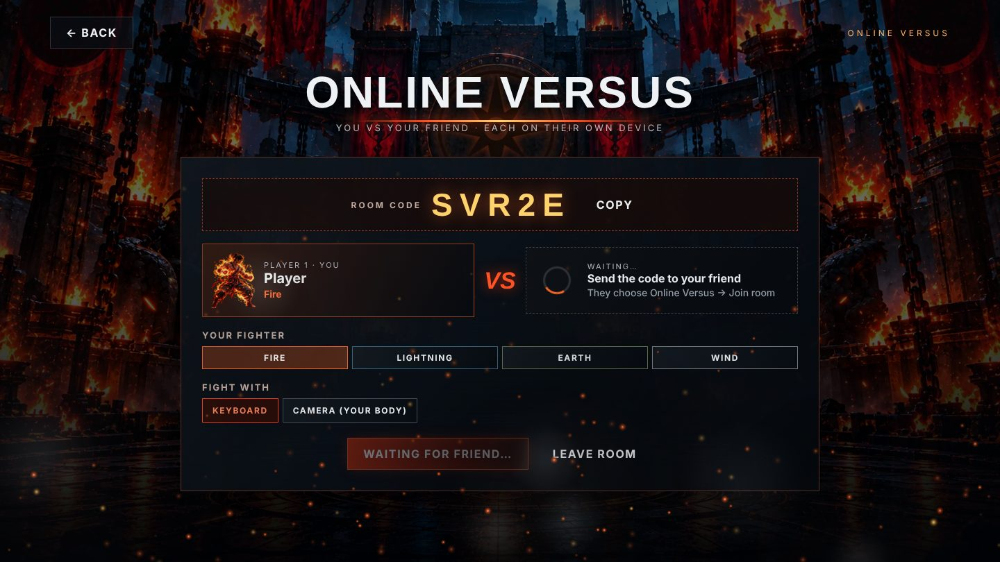

<div align="center">

# 🔥 GESTURE KOMBAT ⚡

### Your body. Your power.

**An elemental fighting game you play with your whole body, right in the browser.**
Punch, kick, block and unleash elemental specials in front of your webcam, and a 3D fighter copies every move in real time.

**[▶ Play now: funny-choux-d51a43.netlify.app](https://funny-choux-d51a43.netlify.app)**



</div>

---

## ✨ Features

- **Full-body control.** On-device pose tracking (MediaPipe) turns your movements into moves: punch, double punch, kick, block, jump, crouch, walk, run and elemental specials.
- **Live 3D fighters.** Four rigged 3D fighters (Fire, Lightning, Earth, Wind) copy your arms, legs and torso as you move, through a custom WebGL2 GPU-skinning renderer.
- **Online versus with room codes.** Create a room, send the 5-letter code to a friend, and fight each other from two different devices. Uses Supabase Realtime.
- **Accounts.** Continue with Google, or sign up with a username and email. Includes a welcome email, password reset with an emailed code, and stats synced across devices. Guest play is always available.
- **Single player, training and same-device versus.** CPU opponents at four difficulty levels, a sparring dummy, and two players on one keyboard.
- **Move Academy.** A 3D coach shows each gesture step by step, including how to charge and fire your elemental special.
- **Arcade presentation.** Cinematic intro, molten-title loading screen, hit-stop, screen shake, elemental VFX and an original synthesized soundtrack (Web Audio).
- **Private by design.** Video never leaves your device. Only the move or pose data the game needs is sent, and only during online matches.

## 📸 Screenshots

| Loading | Battle |
|---|---|
|  |  |
| **Move Academy** | **Online versus** |
|  |  |

## 🎮 How to play

| Move | With your body | Keyboard |
|---|---|---|
| Punch | Snap one fist forward | `J` |
| Double punch | Throw both fists forward together | `U` |
| Kick | Lift a knee quickly | `K` |
| Block | Both fists up in front of your face | `L` (hold) |
| Special | Palms together at your chest (needs half energy) | `F` |
| Jump | Hop | `W` / `Space` |
| Crouch | Squat down | `S` |
| Walk forward / back | Step toward / away from the camera, or march in place | `A` / `D` |
| Run | Jog in place | `Shift` + move |

Stand 2–3 m from the camera so it sees you from head to knees, then hold still for a second to calibrate.

**Play a friend online:** Play → **Versus a Friend** → **Create room**, then send the code. Your friend opens the same link → **Versus a Friend** → types the code → **Join room**.

## 🛠 Tech

- Vanilla JavaScript ES modules, no framework or build step
- MediaPipe Tasks Vision PoseLandmarker, run in a Web Worker for low latency
- Custom WebGL2 renderer with GPU skinning and Canvas 2D effects
- Web Audio for all sound effects and the original music
- Supabase for auth (Google OAuth, email/password, OTP reset), Postgres with row-level security, and Realtime for online rooms
- Hosted on Netlify

## 📁 Project structure

```
game/                The game. This folder is the whole website.
  index.html
  css/main.css
  js/                Engine, menus, gestures, 3D renderer, audio, auth, online
  assets/            Art and 3D fighter models
  supabase/          Database setup SQL, email templates, setup guide
tools/rig/           Python pipeline that rigs the 3D fighter models
docs/                Screenshots and the earlier Next.js arena prototype notes
app/, components/…   Earlier Next.js "web arena" prototype
```

## 🚀 Run it yourself

```bash
cd game
python3 -m http.server 8000
# open http://localhost:8000 in Chrome
```

To deploy, drop the `game` folder on [Netlify Drop](https://app.netlify.com/drop), or connect this repo and set the publish directory to `game`. Accounts and online rooms need a Supabase project; see [`game/supabase/SETUP.md`](game/supabase/SETUP.md).

## 👥 Team

Built by:

| | |
|---|---|
| **Jithendra Gudapati** | [@jithendragudapati1-cmd](https://github.com/jithendragudapati1-cmd) |
| **Shasmith Dokuri** | [@ShasmithDokuri](https://github.com/ShasmithDokuri) |

---

<div align="center"><sub>Fire · Lightning · Earth · Wind. Choose your element.</sub></div>
